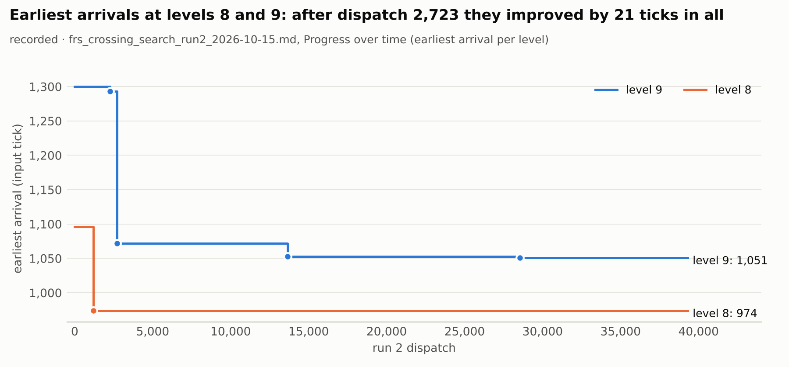
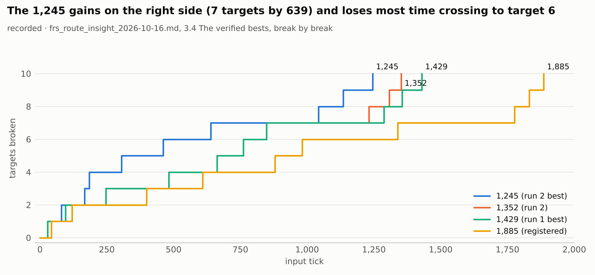
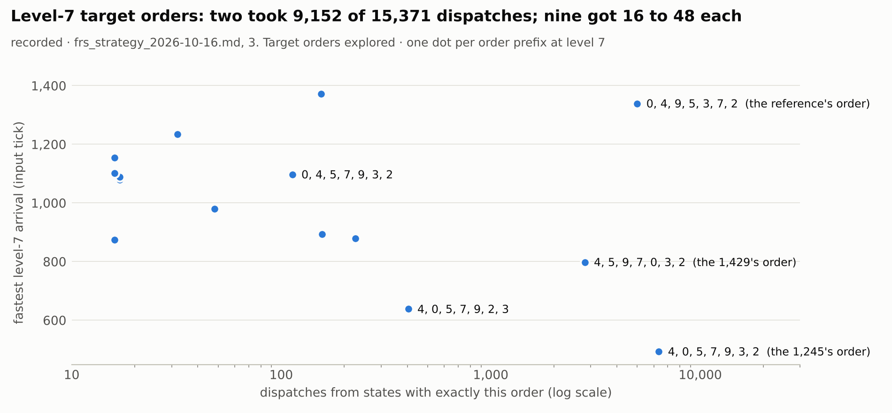
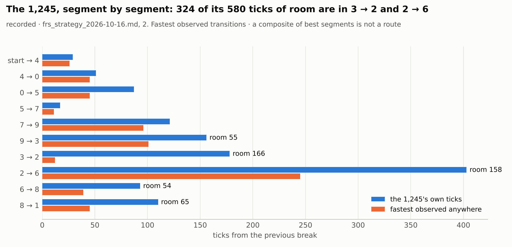
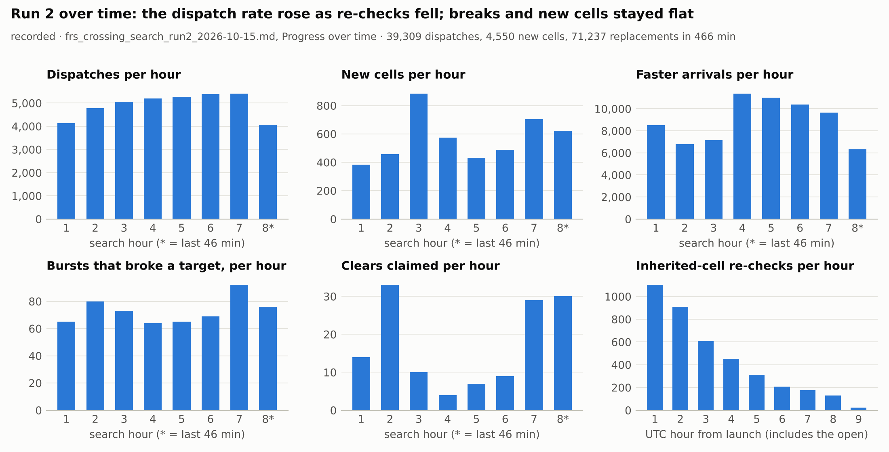
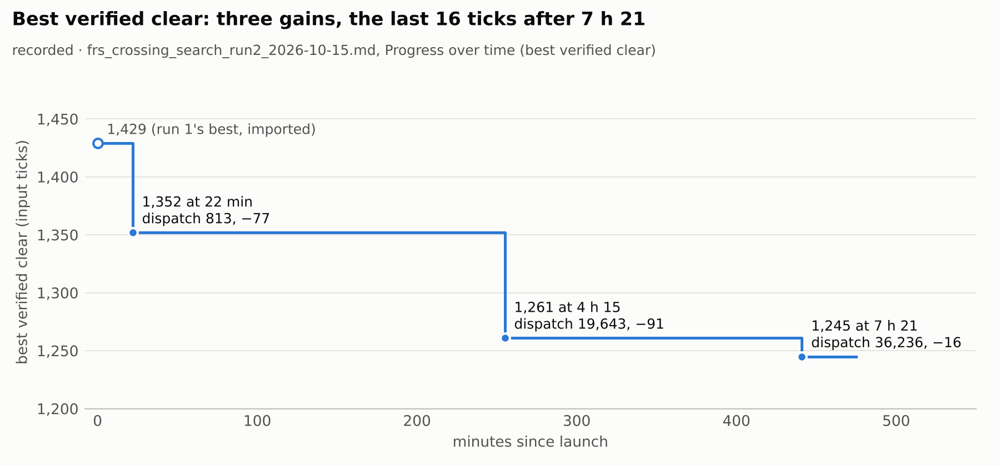
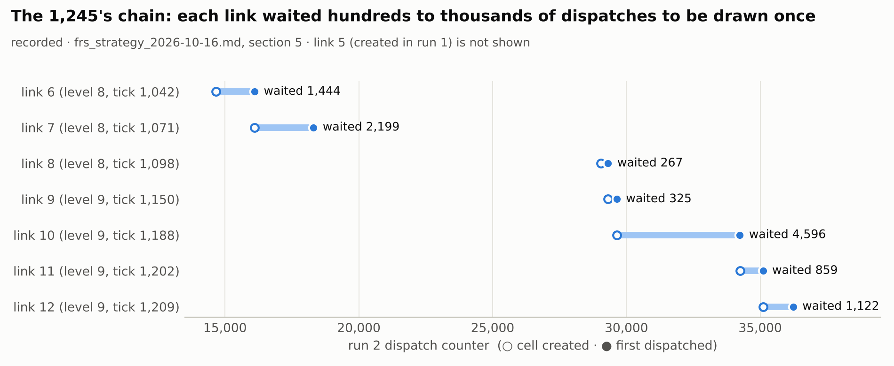
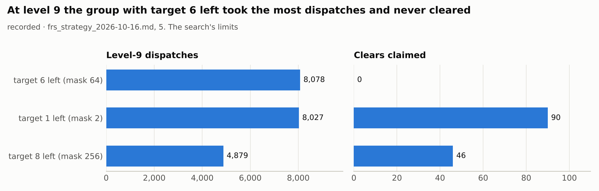
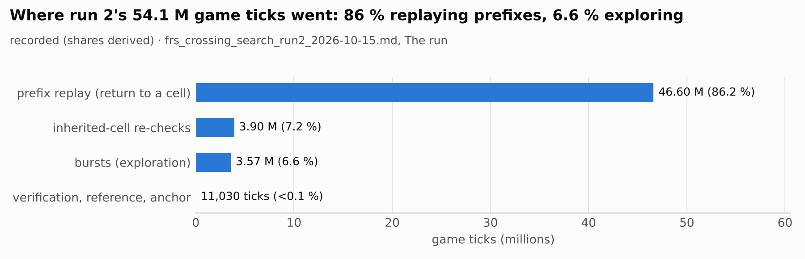
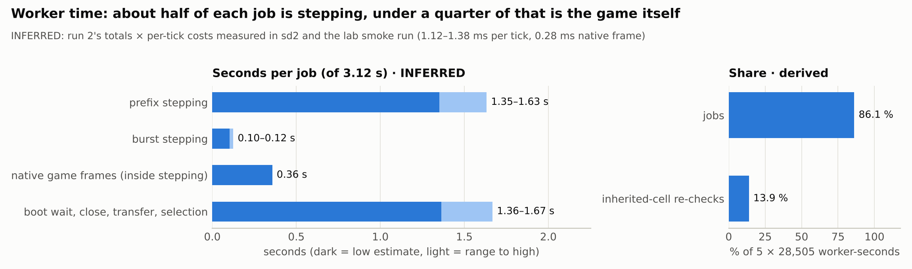

# Run 2 analysis (crossing search run 2, 2026-10-16), read-only

## 0. Sources, evidence levels, and what is not here

**No raw run data is in the repository.** Run 2's rows are `C:/BattleShip_lab/crossing_2026-10-15_run2/run/*.jsonl`, and run 1's,
the archive's and the traces are git-ignored on the PC. This analysis therefore works from the five **committed records** that
summarise them:

- `docs/frs_crossing_search_run2_2026-10-15.md`: run 2's own record.
- `docs/frs_strategy_2026-10-16.md`: the lineage rebuild over every lab dispatch.
- `docs/frs_route_insight_2026-10-16.md`: orders and the verified bests break by break.
- `docs/frs_anomaly_inventory_2026-10-16.md`: an offline scan of 510 traces.
- `docs/frs_prefix_cost_2026-10-14.md`: per-tick costs measured in sd2 and the smoke run.

Nothing was re-measured, and no explorer code was changed.

| tag | meaning |
| --- | --- |
| **[recorded]** | a number a record states; the lab measured it |
| **[derived]** | arithmetic on recorded numbers of the same run: sums, shares, differences |
| **[inferred]** | combines run 2's numbers with costs measured in other runs, or rests on a stated assumption; treat as an estimate |

**Reproducible.**

- `tools/analysis/run2_records.py` parses the records into `docs/analysis/run2/run2_records.json`. Every dataset names its record
  and section.
- `tools/analysis/run2_charts.py` draws the ten charts below.
- The parser runs **14 consistency checks** between each record's tables and its own totals, and **all 14 hold**. Examples:
  - the eight hourly rows sum to the run's 39,309 dispatches, 4,550 new cells, 71,237 replacements, 584 breaking bursts,
    24,285 falls and 136 claimed clears;
  - the tick categories sum to 54,086,814;
  - the level-9 groups sum to the 20,984 level-9 dispatches;
  - the 1,245's segments sum to 1,245.
- `tools/analysis/run2_lab.py` computes the same analyses, and measured worker time, from the raw folder on the PC (section 6).

## 1. Best arrival per target and per target order

### 1.1 Per level [recorded]



| level | run 1's earliest | run 2's improvements (tick at dispatch) | earliest at the stop | lead on the registered 1,885 |
| ---: | ---: | --- | ---: | ---: |
| 9 | 1,300 | 1,293 at 2,274; 1,072 at 2,723; 1,053 at 13,636; 1,051 at 28,551 | **1,051** | 781 |
| 8 | 1,096 | 974 at 1,188 | **974** | 802 |
| 7 | 493 | none | 493 | 846 |
| 6 | 461 | none | 461 | 521 |

**[derived]** After dispatch 2,723, the earliest arrivals at levels 8 and 9 improved by 21 ticks in all, over the remaining
36,586 dispatches.

### 1.2 Per target [derived from recorded break tables]

The tick at which each target broke in each verified best (the route-insight report's exact break tables), and the earliest among
them. This is the earliest **among these verified clears**, not over every trajectory. Every burst's breaks are in the raw rows;
`run2_lab.py` computes that on the PC.



| target | 1,245 | 1,261 | 1,352 | 1,429 | 1,588 | 1,884 | 1,885 | earliest |
| ---: | ---: | ---: | ---: | ---: | ---: | ---: | ---: | ---: |
| 0 | 80 | 80 | 663 | 663 | 663 | **43** | **43** | 43 (1,884) |
| 1 | **1,245** | 1,261 | 1,352 | 1,429 | 1,447 | 1,884 | 1,885 | 1,245 (1,245) |
| 2 | **639** | **639** | 848 | 848 | 848 | 1,338 | 1,339 | 639 (1,245) |
| 3 | **461** | **461** | 761 | 761 | 761 | 880 | 880 | 461 (1,245) |
| 4 | 29 | 29 | **28** | **28** | **28** | 120 | 120 | 28 (1,352) |
| 5 | 167 | 167 | **95** | **95** | **95** | 609 | 609 | 95 (1,352) |
| 6 | **1,042** | **1,042** | 1,231 | 1,288 | 1,288 | 1,775 | 1,776 | 1,042 (1,245) |
| 7 | **184** | **184** | 482 | 482 | 482 | 982 | 982 | 184 (1,245) |
| 8 | **1,135** | 1,195 | 1,307 | 1,356 | 1,588 | 1,831 | 1,832 | 1,135 (1,245) |
| 9 | 305 | 305 | **246** | **246** | **246** | 399 | 399 | 246 (1,352) |

Reading:

- No single clear holds every target's earliest break.
- The 1,352 family reaches targets 4, 5 and 9 sooner.
- The registered route breaks target 0 at 43.
- The 1,245 is fastest on the other six.

The 1,245's whole gain is the right side: seven targets by 639, against 848 for the 1,352 family. Its crossing to target 6 is its
longest segment, 403 ticks (section 1.4).

### 1.3 Per target order [recorded]

The five complete orders the agent has ever produced. The record's count mixes claimed clears (run 2 replayed only faster ones) and
verified ones; the first row says "22 claims".

| complete order | fastest clock | clears with it | composite of best segments |
| --- | ---: | ---: | ---: |
| 4, 0, 5, 7, 9, 3, 2, 6, 8, 1 | **1,245** (run 2) | 22 (claims) | 665 |
| 4, 0, 5, 7, 9, 3, 2, 6, 1, 8 | 1,280 (run 2) | 46 | 770 |
| 4, 5, 9, 7, 0, 3, 2, 6, 8, 1 | 1,352 (run 2; 1,429 in run 1) | 157 | 497 |
| 4, 5, 9, 7, 0, 3, 2, 6, 1, 8 | 1,588 (run 1) | 209 | 602 |
| 0, 4, 9, 5, 3, 7, 2, 6, 8, 1 | 1,885 (archive) | 21 | 780 |

There are 180 order prefixes across the archive and the lab: 38 at level 4, 33 at level 5, 19 at 6, 15 at 7, 12 at 8, 9 at 9, and
5 complete.



| level-7 order prefix | fastest arrival | dispatches from states with exactly this prefix |
| --- | ---: | ---: |
| 4, 0, 5, 7, 9, 3, 2 (the 1,245's) | 493 | 6,341 |
| 4, 0, 5, 7, 9, 2, 3 | 638 | 404 |
| 4, 5, 9, 7, 0, 3, 2 (the 1,429's) | 798 | 2,811 |
| 4, 0, 5, 7, 3, 9, 2 | 874 | 16 |
| 4, 0, 5, 7, 9, 2, 6 (target 6 before 3) | 879 | 226 |
| 0, 4, 9, 5, 3, 7, 2 (the reference's) | 1,339 | 5,002 |

The other nine prefixes got 16 to 157 dispatches each.

**[derived]** Two orders took 9,152 of the 15,371 level-7 dispatches (60 %). Most other orders got a few dozen, including
4, 0, 5, 7, 3, 9, 2, the fourth fastest at 874, with 16.

### 1.4 The 1,245 segment by segment [recorded]



The 1,245 has 580 ticks of room against the fastest transition observed anywhere for each of its consecutive pairs. 324 of them are
in 3 → 2 (178 against 12) and 2 → 6 (403 against 245). **A composite of best segments is not a route**: the parts come from
different trajectories and states, and the strategy review puts the physically coherent composite at about 860.

## 2. Cells and dispatches over time: where exploration stalls



| hour | dispatches | new cells | per 1,000 dispatches | replacements | bursts that broke a target | per 1,000 | clears claimed | falls (share) |
| ---: | ---: | ---: | ---: | ---: | ---: | ---: | ---: | ---: |
| 1 | 4,145 | 384 | 93 | 8,531 | 65 | 15.7 | 14 | 2,094 (51 %) |
| 2 | 4,776 | 457 | 96 | 6,800 | 80 | 16.8 | 33 | 2,981 (62 %) |
| 3 | 5,055 | 883 | 175 | 7,163 | 73 | 14.4 | 10 | 3,441 (68 %) |
| 4 | 5,198 | 575 | 111 | 11,355 | 64 | 12.3 | 4 | 3,363 (65 %) |
| 5 | 5,274 | 432 | 82 | 10,997 | 65 | 12.3 | 7 | 3,459 (66 %) |
| 6 | 5,384 | 490 | 91 | 10,392 | 69 | 12.8 | 9 | 3,465 (64 %) |
| 7 | 5,401 | 706 | 131 | 9,666 | 92 | 17.0 | 29 | 3,198 (59 %) |
| 8* | 4,076 | 623 | 153 | 6,333 | 76 | 18.6 | 30 | 2,284 (56 %) |

\* hour 8 is the last 46 minutes. Counts **[recorded]**; rates and shares **[derived]**. The inherited-cell re-checks per UTC hour
were 1,101, 911, 609, 451, 311, 206, 174, 129 and 24 **[recorded]**.







Where it stalls:

1. **The deepest arrivals stopped moving almost at once [recorded / derived].** Levels 8 and 9 reached 974 and 1,072 by dispatch
   2,723 and then gained 21 ticks in all. The best verified clear still improved twice afterwards (1,261 at dispatch 19,643 and 1,245
   at 36,236), so progress came from completing states that already existed, not from reaching new depths earlier.
2. **Good states waited to be drawn [recorded].** The 1,245's chain needed 13 of the 39,309 dispatches. Each run-2 link waited 267
   to 4,596 dispatches between its creation and its first dispatch, and link 5, kept by run 1, waited about 22,000 across both runs.
   Seven of the eight run-2 links produced the next link on their first dispatch.
3. **A dead-end group absorbed the deepest level's budget [recorded].** At level 9, the group with target 6 left (mask 64) took
   8,078 dispatches for 0 breaks and 7,327 falls (91 %), and holds the earliest level-9 arrivals of the run (1,051 to 1,072). The
   groups with target 1 or 8 left took 8,027 and 4,879 for 90 and 46 claimed clears.
   - The two records count this differently, and both are right: the strategy review counts all level-9 dispatches per group; the
     run-2 record counts seed 579's descendants only (7,996, 7,619 and 4,813).
   - The clearing groups' fastest starts ahead of pace were first dispatched in the last hour (run-2 record).
4. **Faster arrivals were mostly not followed up [recorded].** 71,237 replacements, but 72 to 82 % of the faster states were never
   dispatched afterwards (strategy review, runs 1 and 2). 3,048 eligible cells were never drawn at all.
5. **Rates did not decay [derived].**
   - New cells per 1,000 dispatches stayed between 82 and 175, highest in hours 3, 7 and 8.
   - Breaking bursts per 1,000 stayed between 12 and 19.
   - So the archive was not exhausted: the selection, not the frontier, was the limit. This matches the strategy review's
     conclusion, now visible hour by hour.

Signals the selection used, against outcomes **[recorded]**:

| signal | bucket | jobs | broke a target | new cells per job |
| --- | --- | ---: | ---: | ---: |
| break bonus | cells with a break record | 1,037 | 21.5 % | 0.10 |
| | without | 38,272 | 0.94 % | 0.12 |
| seen penalty | seen 0 to 2 | 7,857 | 2.15 % | 0.46 |
| | 16 and more | 18,399 | 1.05 % | 0.01 |
| novelty | fresh 0 | 25,032 | 1.50 % | 0.15 |
| | 4 to 15 | 1,808 | 1.83 % | 0.03 |

**[derived]** A break record multiplies the break rate by about 23. The run-2 record notes that it is dominated by starts that
cleared and cleared again.

## 3. How worker time is spent



**Game ticks [recorded; shares derived]:**

| category | ticks | share |
| --- | ---: | ---: |
| prefix replay (returning to a cell) | 46,603,859 | 86.2 % |
| inherited-cell re-checks | 3,903,197 | 7.2 % |
| bursts (exploration) | 3,568,728 | 6.6 % |
| verification, reference, anchor | 11,030 | < 0.1 % |

**Worker-seconds [derived]:**

- 5 workers × 28,505 s = 142,525 worker-seconds.
- Re-checks used 19,772 of them: **13.9 %**.
- The rest is 122,753 s over 39,309 jobs: **3.12 s per job**.



**Per job [inferred].** Run 2 recorded counts, not a time split per job: 1,276 ticks per job, of which 91 were burst words. The
split below multiplies those counts by the per-tick costs **measured in sd2 and the lab smoke run** (1.12 to 1.38 ms per stepped
tick under load, of which about 0.28 ms is the native game frame; `docs/frs_prefix_cost_2026-10-14.md` 2.3).

| part of a 3.12 s job | seconds | share |
| --- | ---: | ---: |
| prefix stepping | 1.35 to 1.63 | 43 to 52 % |
| burst stepping | 0.10 to 0.12 | 3 to 4 % |
| of the stepping: the native game frames | about 0.36 | about 11 % |
| standby boot wait, close, transfer, ingest, selection (the remainder) | 1.36 to 1.67 | 44 to 53 % |

**Cross-check [recorded elsewhere].** The prefix-cost record measured 52 % for the same remainder in sd2 (standby wait 22.4 % plus
outside the job clock 30.0 %), and 41 % for prefix stepping. The inference is consistent with it.

**Measure it instead.** `run2_lab.py` sums the per-job `wall_s` (job clock), `step_s` and `ask_s` from run 2's dispatch rows, plus
the checks' and verifications' walls, and reports the remainder outside the job clock. That replaces this table with measured
numbers.

## 4. Unexpected things

None of these is a game finding. Anything in the anomaly scan counts only after a replay from tick 0.

1. **The earliest arrival is not the best start [recorded].** The run's earliest level-9 states (1,051 to 1,072) are all in the group
   that never cleared. Arrival time alone, which is what the pace term reads, steered half of level 9's budget into a dead end.
2. **Very short segments are mostly one move or one projectile [recorded].**
   - 5 → 7 is 17 ticks at the median over 1,431 observations (best 11): one up-B through both targets.
   - The fastest 3 → 2 (12 ticks, against the 1,245's 178) and 9 → 0 (2 ticks) are a projectile or a hit on arrival.
   - The scan found 4 breaks with the fighter 3,435 to 5,044 units from the target, each with a fireball near it, and 5 point-blank
     at 20 to 88 units.
3. **One moving-line oddity in a run-2 clear [recorded, flagged, not confirmed].** In the 1,261's trace at tick 626 the fighter
   moved +17.5 with the moving line on a status-change tick (`EscapeB → SpecialLw`) while the recorded carry reads 0. The anomaly
   inventory's own recommendation is to check whether the carry field is simply unset on a status's first tick. That would be a
   diagnostic gap, not a game effect.
4. **Lineage concentration [recorded].**
   - 5,731 of the 7,382 level-9 cells, and 121 of the 133 claimed clears that were not replayed, descend from one seed (579).
   - The other clearing family (seed 417) produced the 1,352.
5. **The level-7 state that is fastest never crosses [recorded].** The 493 arrival at level 7 (helpless, top right) was dispatched
   twice in two runs and never crossed. Every crossing so far started grounded or with double jump and up-B near the platform.
6. **Falls dominate outcomes [recorded / derived].** 62 % of all bursts and 73 % at level 9 ended in a fall. Their share rose from
   51 % in hour 1 to 64–68 % in hours 3 to 6.
7. **133 of 136 claimed clears were never replayed [recorded].** That is by the replay-only-when-faster rule (decision Q10). Their
   words are kept, and one equals the best at 1,245.

## 5. What this suggests for the run 3 decisions

Each item names the decided component it supports or questions (`docs/rl_decisions_2026-10-16.md`, Q2 to Q11) and the evidence
behind it.

1. **Per-(level, mask) group budget, decided Q2: strongly supported [recorded].** One group took 8,078 level-9 dispatches for
   0 breaks while the clearing groups' best starts waited until the last hour. **[inferred]** A group floor plus a break-rate share
   would have moved most of that group's dispatches to the clearing groups. How many depends on the floor chosen.
2. **Rank draw and anchors, decided Q3 and Q4: supported [recorded].** The chain waits of 267 to 4,596 dispatches per link, and the
   72 to 82 % of faster arrivals never dispatched, are exactly what anchors that are drawn soon after their creation fix.
   - **Caution [recorded, item 4.1]:** rank by arrival tick alone would have favoured the mask-64 group's 1,051 arrival. The rank
     must be taken *within* the group, which the decided budget does, and the group share must follow breaks, not arrival.
3. **Store end records, now in progress in a local session: worth 13.9 % of worker time [derived].** That is also 7.2 % of all ticks
   and most of the first two hours' slowdown. Import run 2's 3,916 check results as end records too (review O10), so run 3 starts
   with none to redo.
4. **Breadth reserve, an addition in `REVIEW_2026-11-03.md` 2.6: supported [recorded / derived].**
   - Two level-7 orders took 60 % of that level's dispatches.
   - 4, 0, 5, 7, 3, 9, 2, the fourth-fastest level-7 order at 874, got 16.
   - No order outside two families has ever reached level 8.
   - A fixed order-niche share is cheap insurance.
5. **The break record is the strongest per-cell signal recorded (×23) [derived].** It is inflated by re-clearing starts, so use it
   per *group* (as Q2's break-rate share does) rather than raising the per-cell bonus.
6. **Falls: an open question, not a decided item [inferred].** With 62 % of bursts ending in a fall and 91 % in the dead-end group,
   a generic early end on a fall-bound state could save burst ticks. But the bursts are only 6.6 % of the ticks, so the payoff is
   small until the prefix cost (86 %) falls. Not recommended for run 3; revisit after the soft reset.
7. **Throughput order [inferred].** About half of each job is outside stepping (section 3), so the soft reset (C) attacks the larger
   share. The native batched prefix then attacks the 43–52 % that is prefix stepping. Measure first with `run2_lab.py` (section 6),
   because the split here is inferred.
8. **Reproducibility (D4, built on `cloud/2026-11-04-infra`) [measured on the fake game].** With end records stored, run 3 can use
   `DeterministicSchedule`. Then a CONTROL and an arm can share their draws, and any surprising state found in run 3 can be found
   again by re-running the same seed.
9. **Plateau reading, decided Q11 [recorded].** In run 2 the best improved at 22 min, 4 h 15 and 7 h 21, and the earliest
   arrivals stopped after the first 3,000 dispatches. A plateau read on "earliest arrival per group" alone would have stopped run 2
   before its two best clears. Keep reading verified clears as well, as Q11 says.

## 6. Reproduce and validate locally

No native ticks. From the checkout, on this branch:

```bash
python -B tools/analysis/analysis_tests.py
```

Expect `analysis tests: 4/4 passed` (14 record consistency checks, the raw-folder script on a known synthetic folder, the refusal to
write into a run folder, ten charts).

```bash
python -B tools/analysis/run2_records.py
```

Expect `13 datasets, 14 consistency checks, 0 failing`. It rewrites `docs/analysis/run2/run2_records.json` identically.

```bash
python -B tools/analysis/run2_charts.py
```

Expect `wrote run2_hourly.png, … run2_segments.png`, the ten charts above.

On the raw run 2 folder (read-only; writes only under `--out`; keep `--out` inside the lab root if the lab guard matters to you):

```bash
python -B tools/analysis/run2_lab.py --run C:/BattleShip_lab/crossing_2026-10-15_run2/run --out C:/BattleShip_lab/analysis/run2_lab
```

What to expect:

- `39,309 dispatches, 3 verified clears`.
- `lab_analysis.json` holds the measured worker time (job clock, stepping, continuation questions, checks, verification, and the
  remainder outside the job clock, which section 3 could only infer).
- The earliest break of every target over every burst: each must be at or before the "earliest" column of 1.2.
- The (level, mask) group table: level 9's three groups must show the dispatches of 2.3.
- The short-gap and position-outlier lists.
- Levels whose earliest arrival was inherited from run 1 (7 and 6) show run 2's own earliest arrival there, not the inherited one.
  Pass run 1's folder separately for those.

The script was tested in the cloud only on a fake-game run folder (the same writer code, a synthetic world) and on a handcrafted
folder.
